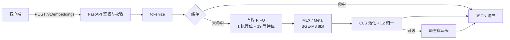

# BGE-Embedding

**Apple Silicon 上的自托管 BGE-M3 嵌入推理服务。**

面向知识库与 RAG 的内网 Embedding API：一台 Mac mini、一个模型进程，返回 1024 维稠密向量与可选的 token 级稀疏权重。接口沿用 OpenAI Embeddings 的基础请求形状，模型、文本与向量都留在本地，不依赖外部推理服务。

> BGE-M3 8bit · 1024 维 dense · 可选 sparse · 8192 tokens · 单机常驻
>
> Python 3.12 · FastAPI / Uvicorn · MLX / Metal

## 为什么是这套组合

BGE-M3 原生同时提供 dense 与 sparse 信号，不需要为了词面匹配再维护第二个模型；MLX 直接利用 Apple Silicon 的 Metal 与统一内存，把延迟、内存和隐私边界收在同一个进程里。单 worker 串行执行配合有界队列，换来的是可预测的单机资源占用，而不是通用高并发。

设计依据见 [ADR-0002](docs/adr/0002-bge-m3-mlx.md)、[ADR-0005](docs/adr/0005-native-sparse-head.md)、[ADR-0008](docs/adr/0008-cross-request-micro-batching.md)。

## 能力

- **私有部署**：权重本地加载并固定 revision / SHA-256；运行时不下载模型、不调用外部 API；请求文本与向量不落盘。
- **一次前向，两路信号**：`return_sparse=true` 时 dense 与 sparse 共享同一次前向，可直接做语义 + 词面混合检索。
- **有界资源**：单 worker、1 执行位 + 19 等待位，队列满或等待超 30 秒返回 429；请求体、批量、token 均有硬上限。
- **重复请求复用**：进程内按字节上限的 LRU 缓存，全命中请求不占执行位；同一请求内的重复文本只推理一次。
- **吞吐优化**：批内按长度分桶合批，等待中的兼容请求按 15 ms 窗口跨请求微合批；FP16 attention 与逐层求值降低峰值内存。
- **可运维**：私有 TOML 集中配置并在启动时严格校验；`/healthz` 探活；launchd 常驻；日志只记录安全元数据，含 `wait_ms` / `exec_ms` / `ahead` / `dedup`。

## 请求路径



同一请求内未命中条目按长度分桶、右 padding 后合批前向；队列中存在同 `return_sparse` 的短请求时进行跨请求微合批，不增加执行位。缓存只驻留进程内存，重启即清空。合批主要摊薄每请求固定开销，1k tokens 以上的长块收益接近于零。

## 快速开始

已有部署时只需地址与 Key，见[连接与使用](docs/service-connection.md)。以下是自建流程，命令均在项目根目录执行。

### 前置条件

- Apple Silicon（arm64）Mac，macOS 26 或以上（当前 MLX wheel 的要求）
- 建议 16GB 统一内存
- Miniconda 或 Miniforge，项目环境名 `bge-embedding`
- 约 604 MB 模型权重，首次获取需要网络

| 组件 | 版本 |
| --- | --- |
| Python | 3.12.15，arm64 |
| MLX / mlx-metal | 0.32.4 |
| mlx-embeddings / mlx-vlm | 0.1.0 / 0.4.0 |
| FastAPI / Uvicorn | 0.143.1 / 0.54.0 |
| 模型 | `mlx-community/bge-m3-mlx-8bit`，revision 见[模型说明](models/README.md) |

完整版本与 wheel 哈希见 [requirements.lock](requirements.lock)。

### 安装与获取模型

```sh
conda env create -f environment.yml
conda activate bge-embedding
python -m pip install -r requirements.lock
python -m pip install --no-deps --no-build-isolation -e .
python -m pip check

hf download mlx-community/bge-m3-mlx-8bit \
  --revision 7eca4a1c6ea1a0c5efc37598b369012f3985910f \
  --local-dir models/bge-m3-mlx-8bit
python deploy/fetch_sparse_head.py
```

权重与稀疏头都不入库，来源与校验值见[模型说明](models/README.md)。稀疏头是启动前置条件：缺失时即使只调用 dense，服务也会拒绝启动，不会静默降级。

### 配置与启动

```sh
python deploy/install.py --config "$PWD/config.toml"
python -m bge_embedding --config "$PWD/config.toml"
```

`install.py` 依据 [config.example.toml](config.example.toml) 生成权限 600 的 `config.toml`（含随机 Key）与 launchd plist，但不启动服务；参数集中在 TOML，启动时严格校验。常驻、登录自启与停止见[部署说明](deploy/README.md)。

### 冒烟

另开终端：

```sh
python tests/verify_http.py --config "$PWD/config.toml" --sparse
```

检查健康状态、鉴权、单条 / 批量、向量形状与稀疏输出；`--long` 追加 8192-token 输入。

## API

`POST /v1/embeddings`，共享 Key 鉴权。`GET /healthz` 免鉴权：就绪返回 `200 {"status":"ready"}`，否则 `503 {"status":"not_ready"}`。

| 字段 | 必填 | 说明 |
| --- | --- | --- |
| `model` | 是 | 固定为 `bge-m3` |
| `input` | 是 | 单个字符串或非空字符串数组；不接受空串、纯空白、token ID 数组 |
| `encoding_format` | 否 | 默认 `float`，仅接受 `float` |
| `return_sparse` | 否 | JSON 布尔，默认 `false`；`true` 时每项额外返回 `sparse` |

```sh
curl -s http://127.0.0.1:8000/v1/embeddings \
  -H "Authorization: Bearer $BGE_API_KEY" \
  -H "Content-Type: application/json" \
  -d '{
    "model": "bge-m3",
    "input": ["知识库文档", "An English query"],
    "encoding_format": "float"
  }'
```

```json
{
  "object": "list",
  "model": "bge-m3",
  "data": [
    {"object": "embedding", "index": 0, "embedding": [0.0123, -0.0456, 0.0789]}
  ],
  "usage": {"prompt_tokens": 10, "total_tokens": 10}
}
```

`embedding` 实际为 1024 项，均为有限值并已完成 L2 归一；`data` 按输入顺序排列，`index` 从 0 开始；`usage` 为整批输入 token 总数。未知字段、错误类型或空输入整单拒绝，不返回部分结果。

稀疏输出每项多一个 `[[token_id, weight], ...]`：同一 token 取最大权重，排除特殊 token，不做归一化或截断。

```json
{"object": "embedding", "index": 0, "embedding": [0.0123, -0.0456, 0.0789],
 "sparse": [[81492, 0.3436], [24471, 0.24]]}
```

索引是 **token id** 整数，可直接作为 Milvus `SPARSE_FLOAT_VECTOR` 字段值插入。需要词面时由调用方用 BGE-M3 tokenizer（XLM-RoBERTa 词表）映射：

```python
from transformers import AutoTokenizer
tok = AutoTokenizer.from_pretrained("models/bge-m3-mlx-8bit")
words = {tok.convert_ids_to_tokens(token_id): w for token_id, w in sparse}
```

`transformers` 不是服务依赖，映射在调用方完成。这是 OpenAI Embeddings 的**兼容子集**：不支持 `dimensions`、`user`、模型列表、base64 输出；使用 OpenAI SDK 时请显式传 `encoding_format="float"`。

### 容量与错误

| 项目 | 默认值 |
| --- | --- |
| 单条输入 | 8192 tokens（含特殊 token），超限拒绝不截断 |
| 单请求 | 16 条 / 32768 tokens / 1 MiB |
| 执行与等待 | 1 个执行位 + 19 个等待位，FIFO |
| 排队超时 | 30 秒（只约束等待时间，不含已开始的推理） |

| HTTP | code | 场景 |
| --- | --- | --- |
| 400 | `invalid_request` / `input_too_long` / `batch_limit_exceeded` | 字段、类型、空输入、长度或批量超限 |
| 401 | `invalid_api_key` | Key 缺失、为空或不匹配 |
| 413 | `request_too_large` | 请求体超过 1 MiB |
| 429 | `queue_full` / `queue_timeout` | 队列已满或等待超时，带 `Retry-After: 1` |
| 503 | `model_unavailable` | 未就绪或正在关闭 |
| 500 | `inference_failed` | 推理异常或输出不符合数值契约 |

错误响应与日志只含固定安全描述，不回显文本、Key 或本地路径。执行位与 worker 固定为 1，其余参数可在私有 TOML 调整。完整规则见 [SPEC-0001](docs/specs/0001-embedding-inference.md)、[SPEC-0002](docs/specs/0002-dense-sparse-output.md)。

## 性能

Mac mini M4 16GB，客户端与服务同机，`batch=1`，固定合成语料：

| 输入长度 | 冷推理 P50 | 缓存命中 P50 |
| --- | ---: | ---: |
| 25 tokens | 25.1 ms | 4.6 ms |
| 945 tokens | 273.9 ms | 7.1 ms |
| 5341 tokens | 2616 ms | 6.8 ms |

- 8192 tokens 冷推理约 4.8 秒；进程峰值内存约 0.6–1.3 GiB（视缓存负载）。冷推理路径约 4 QPS 量级。
- 批内合批对短 / 中批有效（16×25 约 3.3x、16×256 约 1.18x），1k 以上约 1.0x；FP16 attention 再快 18–21%，峰值 977 → 784 MiB。
- 跨请求微合批：20 并发单条 P95 约 380 → 146 ms（进程内 ASGI，非线上 SLA）；无并发等待者时无收益。
- v1.1.0 真实 HTTP 补测：dense 1×512 4,124 tokens/s、16×512 4,467 tokens/s；短查询 40 rps 无拒绝（P95 200 ms）、80 rps 首次 429；30 分钟混合负载 2.25 rps 稳定 3,053.6 tokens/s（P95 1,937 ms）。

以上均为观测值，不是 SLA、容量或吞吐承诺；缓存收益取决于实际重复率，混合负载结论只对记录的请求分布成立。方法与原始数据见 [PLAN-0006](docs/plans/0006-performance-test.md)、[PLAN-0011](docs/plans/0011-batch-inference.md)、[PLAN-0012](docs/plans/0012-inference-optimizations.md)、[PLAN-0015](docs/plans/0015-production-service-validation.md) 及对应 `tests/benchmarks/evidence/`。

## 适用与边界

适合内网知识库 / RAG 的文档入库与在线查询、语义搜索与去重、dense + sparse 混合检索；不负责文件解析与切分、向量库与检索、多租户与配额、多机调度与高可用、容器化部署。

服务面向内网与共享 Key 的非生产场景；用户级 launchd 需要保持登录，机器睡眠或未登录时不承诺可访问。8bit 量化与官方 fp16 不保证逐位一致，项目未做检索效果评测。完整清单见[当前服务的局限性](docs/references/0003-service-limitations.md)。

## 项目结构

```text
src/bge_embedding/   服务实现：API、配置、调度、缓存、MLX 推理
models/              模型来源与获取说明（权重不入库）
deploy/              安装、稀疏头获取、launchd 部署
tests/               单元测试、smoke、真实 HTTP 验证、基准与证据
docs/                PRD / ADR / Spec / Plan
```

```sh
python -m pytest -q                 # 默认 smoke
python -m pytest -q -m 'not real'   # 不依赖真实模型的单元回归
```

## 文档

项目采用 SDD（Specification-Driven Development）：需求、决策、行为契约与实施记录分别落在 PRD、ADR、Spec 和 Plan 中。

- [文档中心](docs/README.md)：流程与全部索引
- [连接与使用](docs/service-connection.md) · [部署说明](deploy/README.md) · [模型说明](models/README.md) · [源码说明](src/README.md)
- [项目进度与交接](HANDOFF.md) · [协作约定](AGENTS.md)
